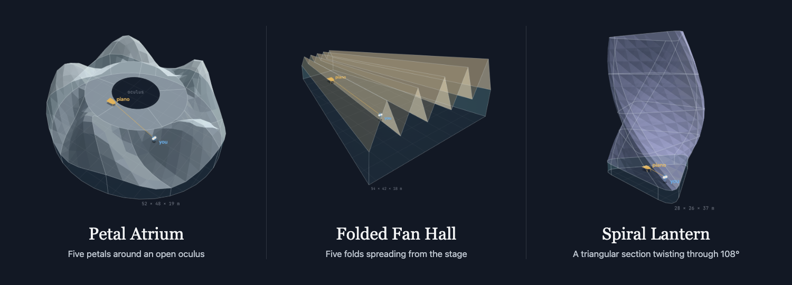

# Nocturne Echo Room

Play a performance, move the listener, and hear how the room changes the sound. Sculpt a parametric concert hall, trace its early reflections, or take a fast Doppler pass through the audience. Available as an offline Mac app and a static web app.



## On a Mac

Download the universal app for Apple Silicon and Intel Macs running macOS 13 or later. Unzip it, move **Nocturne Echo Room** to Applications, and open it. Choose **Room → Design studies**, then press **Play** or **Clap**. [Mac download](https://github.com/LEE-CHENYU/nocturne-echo-room/releases/latest)

Use **File → Open Audio File…** (⌘O) to play a track from your Mac. For tracks you want in the piece selector every time, use **File → Show Music Folder**, copy the audio there, and relaunch. The app reads that folder locally. All three built-in demo tracks play offline.

## In a browser

From a clone, serve the ready-to-play `web` directory with Python 3.

```sh
git clone https://github.com/LEE-CHENYU/nocturne-echo-room.git
cd nocturne-echo-room
python3 -m http.server 8000 --bind 127.0.0.1 --directory web
```

Open the simulator, choose a piece and press **Play**. Headphones make the stereo reflections and moving-listener pitch shifts easier to hear. [Open the local simulator](http://127.0.0.1:8000/#room=petal)

## Project files

| Path | What it is |
|---|---|
| `render.py` | synth-piano Nocturne in the `hall` (48×28×18 m, RT60 ≈2.0 s) or `grand` (90×40×30 m, ≈4.25 s) shoebox |
| `render_real.py` | MAESTRO performance → FluidSynth + Salamander piano (dry) → same pyroomacoustics room |
| `visualize.py` | `out/space_and_echo.png`: plan, image sources, echogram, decay curves, spectrograms |
| `web/template.html` | **the page's source**: UI, acoustics (image sources + Sabine tail), Web Audio, waltz/tango, track loader |
| `web/architecture.js` | Shape parameters, defaults and geometry shared by the renderer and reflection model |
| `web/loft.js` | Ribbon Hall and the panel geometry, reflection paths and wave tracer used by the design studies |
| `web/studies.js` | Radial petal roof, folded fan auditorium and twisting lantern envelope |
| `web/doppler.js` | Listener motion, travel times to each ear and Doppler pitch readout |
| `web/build.py` | Combines the template, room geometry, Doppler controls and note onsets into `index.html` (`--assets` re-renders audio and onsets from `midi/`) |
| `macos/` | Swift/AppKit window, WebKit bundle loader, original app icon and universal app builder |
| `web/*_lossless.mp4`, `*.mp3` | dry audio the page loads (FLAC in MP4; MP3 fallback) |
| `web/skaters_sousa_1912.mp3` | Waldteufel, The Skaters' Waltz, Sousa's Band, 1912; public domain, Library of Congress National Jukebox via archive.org (`loc-jukebox-128290-…`), file unchanged |
| `midi/` | MAESTRO v3 MIDI (CC BY-NC-SA 4.0) and the Mutopia Nocturne |

The included demos are ready to play. Piano rendering uses an additional Salamander SF2 sound bank. [Music sources and licenses](ASSETS.md)

## Editing a room

Choose a room and expand **Architecture**. Dimensions are in metres. Profile controls are relative to the named dimension, so resizing a hall preserves its proportions. Every edit updates the local URL, which you can bookmark to reopen that design. **Restore preset** returns to the original dimensions, finishes, geometry and listening positions.

For example, play the Nocturne in the Pantheon and widen the oculus from 20.8% to 55% of drum diameter. At the preset dimensions and absorption, modeled RT60 falls from 6.40 s to 5.27 s. Setting the diameter to zero closes the opening and yields 6.63 s. These are estimates for the simulated faceted enclosure. The engine uses specular early reflections and a diffuse Sabine decay with air absorption. The plaza terrace count changes the drawing only. Its floor width changes the smooth bank used for sound. Cathedrals use one convex pointed nave and apse without internal columns or side chapels.

### Shaping Ribbon Hall

Ribbon Hall is an original study inspired by the London Aquatics Centre, where one undulating roof spans the swimming and diving pools. Start with a section through each space that needs a different height. In this hall, two high arches and a lower transition give the roof its silhouette. [Zaha Hadid Architects on the London Aquatics Centre](https://www.zaha-hadid.com/architecture/london-aquatics-centre/)

1. Choose **Ribbon Hall** and open **Architecture**. Move **Saddle position** to place the low transition along the hall. Change **Saddle depth** to raise or lower it.
2. Use **Ridge sweep** to move the crown from one side of the hall to the other along its length. Rotate the view to see its S-shaped path from above. **Opposing eave lift** raises alternating roof edges. **End narrowing** pulls the side walls inward at both ends.
3. Turn on **Reflection paths** and press **Clap**. Teal dots mark the roof panels that reflect sound from the piano to your seat in one bounce. Drag the listener to see the reflection points move or disappear.

The hall connects corresponding points on 21 cross-sections to form 480 roof triangles. To build a smooth CAD version, draw the cross-sections in the same direction and loft them in order along the hall. The simulator uses the triangles for reflection and visibility, then estimates the diffuse late reverberation from enclosed volume and absorbing area. [Rhino Loft documentation](https://docs.mcneel.com/rhino/8/help/en-us/commands/loft.htm)

At the preset dimensions of 78 × 38 × 26 m, moving saddle depth from 0% to 65% reduces enclosed volume from 46,239 to 43,932 m³. The modeled 60 dB decay time falls from 3.28 to 3.13 s with the same wall finish.

### Three more design studies

Choose **Room → Design studies** to switch halls during a piece. All three presets use the same wall absorption. The table gives the modeled time for the reverberation to decay by 60 dB at each preset. [Side-by-side views from Echo Room](out/hall-designs.png)

| Design | What to change in Architecture | Default decay |
|---|---|---:|
| Petal Atrium | Five curved petals surround an oculus. Widen it from closed to 55% of the span. The opening grows to 591 m², and the decay falls from 2.34 to 1.84 s at a fixed volume of 23,532 m³. | 2.20 s |
| Folded Fan Hall | Five roof folds spread from the narrow stage toward the back wall. Flatten the folds to increase the volume and lengthen the decay to 2.32 s. | 1.39 s |
| Spiral Lantern | A rounded triangular section rotates through 108° as it rises around one open interior. Reverse the twist to see how the side-wall reflections move. The 37 m crown sends a roof echo back to the preset seat about 210 ms after emission. | 1.92 s |

## Listening for the Doppler shift

Press **Play** and turn on **Doppler mode**. Use **Trajectory** to select a figure eight (the default), an oval lap or a straight pass. You can change paths during playback. The blue outline follows the selected trajectory, and the pitch readout tracks the component of velocity toward or away from the source. Set peak speed from 0 to 100 m/s, or drag the listener to aim a new pass. Turn off **Room sound** to isolate the direct sound at the two ears. Turning off **Doppler mode** resumes the selected sitting or dance mode.

Each ear receives the audio emitted one travel time ago. As the distance to the source shrinks, the listener hears the wave crests arrive closer together. For a stationary source, the direct pitch ratio is `1 − radial velocity / 343`, with velocity in m/s and positive values moving away. On the straight path at 40 m/s peak speed in the large marble room, a 440 Hz reference tone measured 388.7–491.3 Hz at the left output with reflections off. Early echoes use periodically updated room responses, and the late reverberation uses the existing diffuse model. [OpenStax explanation of observer motion](https://openstax.org/books/university-physics-volume-1/pages/17-7-the-doppler-effect)

## Build and test

Edit the template or JavaScript in `web/`, then rebuild the page with Python 3. Run the geometry tests with Node.js 18 or later.

```sh
python3 web/build.py
node --test tests/*.test.cjs
```

To build the Mac app, install Apple’s Command Line Tools and run the following on macOS. The build uses the system WebKit framework, bundles the player and demo audio, and signs the result for local use. A Developer ID identity can be supplied with `--identity` for distribution.

```sh
python3 macos/build.py
open "build/macos/Nocturne Echo Room.app"
```

To check the packaged app’s audio, run the native playback test with the same WebKit asset handler. It plays the three bundled pieces and a temporary library track, checks four room presets, and switches Doppler mode on and off.

```sh
xcrun swiftc -swift-version 5 -parse-as-library macos/HallContent.swift tests/MacPlayback.swift -o build/mac-playback
build/mac-playback "build/macos/Nocturne Echo Room.app"
```

The optional offline Python renderers use NumPy, SciPy, PrettyMIDI, SoundFile, pyroomacoustics and Matplotlib. To regenerate the public piano tracks, install FluidSynth and FFmpeg, put `SalamanderGrandPiano-V3+20200602.sf2` in `soundfonts/`, and run `python3 web/build.py --assets`. [Piano sound bank](https://freepats.zenvoid.org/Piano/acoustic-grand-piano.html)

## License

The original software is MIT-licensed. The bundled MAESTRO performances and their renders carry CC BY-NC-SA 4.0. The Mutopia score and historical recording have their own terms. [Software license](LICENSE) · [Music credits and permissions](ASSETS.md)
